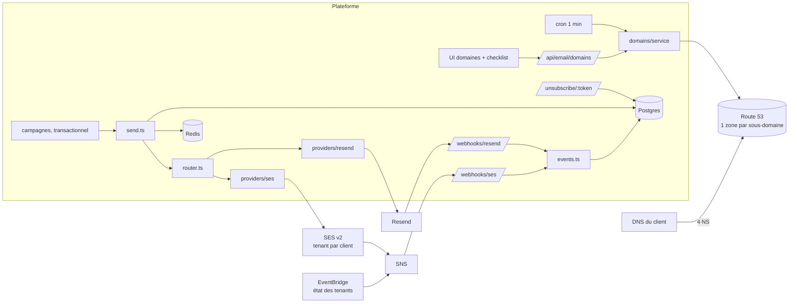
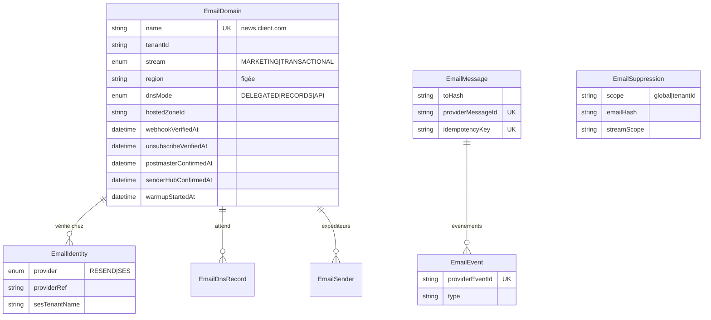
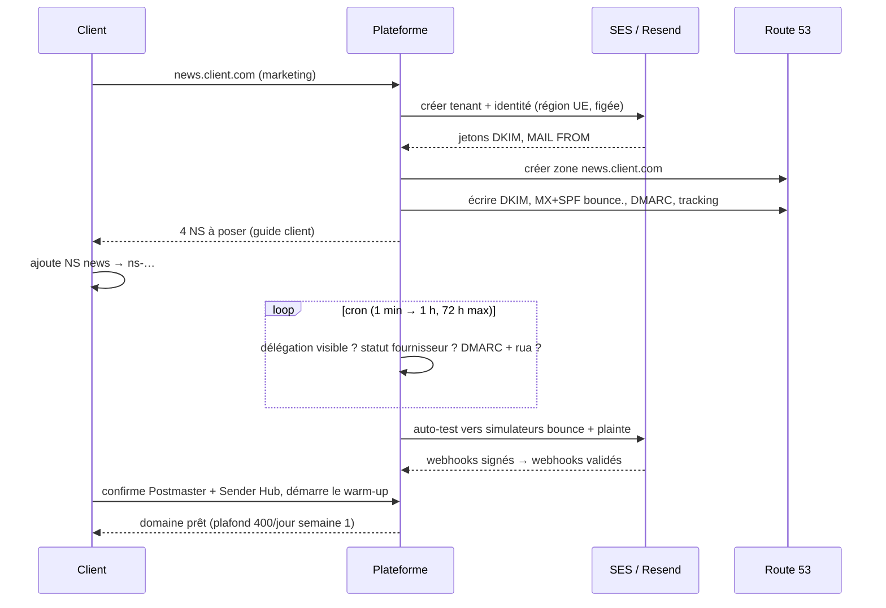
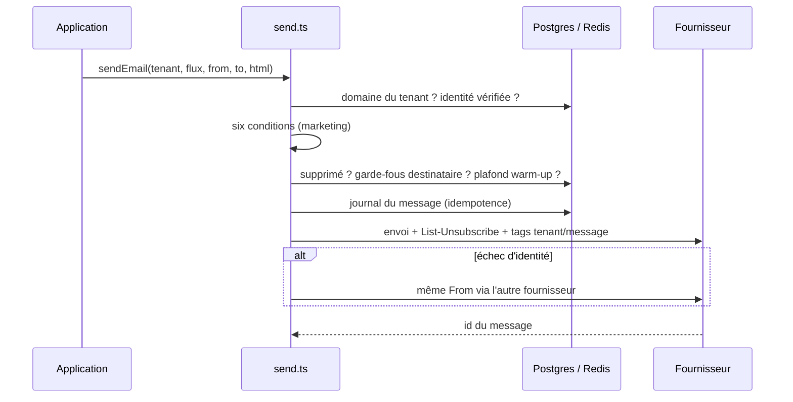

# Brique email multi-tenant — documentation technique

*Version 1.0 — 13 octobre 2026. À copier dans `docs/email.md` de chaque projet qui intègre la brique.*

Cette brique permet à la plateforme d'envoyer des emails **au nom de ses clients, depuis leurs
propres domaines**, avec Resend pour le transactionnel et Amazon SES pour le marketing, et de
brancher le domaine d'un client soit par délégation d'un sous-domaine, soit par enregistrements DNS.

## Sommaire

1. [Périmètre et décisions](#1-périmètre-et-décisions)
2. [Architecture](#2-architecture)
3. [Modules](#3-modules)
4. [Modèle de données](#4-modèle-de-données)
5. [Flux](#5-flux)
6. [API](#6-api)
7. [Configuration et infrastructure](#7-configuration-et-infrastructure)
8. [Sécurité et RGPD](#8-sécurité-et-rgpd)
9. [Mise en service d'un domaine client](#9-mise-en-service-dun-domaine-client)
10. [Exploitation](#10-exploitation)
11. [Quotas et coûts](#11-quotas-et-coûts)
12. [Intégrer la brique dans un projet](#12-intégrer-la-brique-dans-un-projet)
13. [Feuille de route](#13-feuille-de-route)
14. [Glossaire](#14-glossaire)

---

## 1. Périmètre et décisions

| Décision | Choix | Raison |
|---|---|---|
| Transactionnel | **Resend**, région `eu-west-1` | rapide à intégrer, volume faible, risque faible |
| Marketing des clients | **Amazon SES v2**, `eu-west-3`, **un tenant SES par client** | AWS isole réputation, pause et suppression par client ; Resend partage tout entre clients |
| Domaine d'un client | sous-domaine dédié : `news.client.com` (marketing), `mail.client.com` (transactionnel) | la réputation du domaine principal du client n'est pas exposée |
| Branchement DNS | **délégation NS** vers Route 53 par défaut, records copiés en secours | le client agit une fois ; on peut changer de fournisseur sans lui |
| DMARC | `p=none` + `rua` pendant le warm-up, puis `quarantine`, puis `reject` | on ne durcit que sur preuve (rapports) |
| Règles de délivrabilité | appliquées **par le code** à chaque envoi | une checklist finit toujours par être sautée |
| Hors périmètre | MTA propre, IP dédiées, éditeur d'emails, tests de placement | loués ou existants |

Pourquoi pas tout sur Resend : un compte Resend partage entre tous les clients le débit
(10 req/s), la liste de suppression, les contacts et désinscriptions, et des seuils de compte
(bounces < 4 %, spam < 0,08 %) — un seul client fautif peut suspendre l'envoi de tous. Ses données
sont aussi stockées aux États-Unis. Il reste excellent pour le transactionnel.

## 2. Architecture

Un même sous-domaine peut être vérifié chez Resend **et** chez SES (DKIM et Return-Path distincts :
`resend._domainkey` + `send.` / 3 jetons SES + `bounce.`) : si l'identité tombe chez l'un, l'envoi
bascule sur l'autre sans changer l'adresse d'expédition.

## 3. Modules

| Module | Responsabilité |
|---|---|
| `email/types.ts`, `repo.ts` | contrats : domaine, identité, record DNS, email sortant, événement normalisé, accès données |
| `email/prisma-repo.ts` | implémentation Prisma du dépôt (modèle pour Drizzle / Supabase) |
| `email/providers/resend.ts` | domaines (région et Return-Path figés), envoi avec clé d'idempotence, clés restreintes à un domaine |
| `email/providers/ses.ts` | tenant SES, identité Easy DKIM 2048, MAIL FROM, associations au tenant, envoi avec `TenantName` |
| `email/router.ts` | choix fournisseur/identité par flux, contrôle que le domaine appartient au tenant, bascule |
| `email/send.ts` | pipeline unique : portes de mise en service, suppression, garde-fous, warm-up, journal, en-têtes, envoi |
| `email/compliance/unsubscribe.ts` | jetons HMAC sans adresse, en-têtes RFC 8058, traitement one-click |
| `email/compliance/guards.ts` | 5 envois / 10 min et 20 / 24 h par destinataire, pause 24 h après « boîte pleine » |
| `email/compliance/golive.ts` | six conditions, plafond de warm-up, segments ouverts, retenue du palier |
| `email/events.ts` | journal idempotent, suppression (globale / tenant / marketing), auto-test des webhooks |
| `email/webhooks/resend.ts` | vérification Svix, normalisation |
| `email/webhooks/ses-sns.ts` | vérification de signature SNS sans dépendance, normalisation, état des tenants |
| `email/domains/service.ts` | création d'un domaine, rafraîchissement, confirmations, auto-test |
| `email/domains/route53.ts` | zones déléguées, écriture des records, suppression sûre |
| `email/domains/dns-check.ts` | vérification des records, de la délégation et du DMARC effectif |

## 4. Modèle de données

Choix notables : les adresses sont stockées en **empreinte SHA-256** (événements, suppression,
messages) ; `scope = "global"` pour les hard bounces (adresse invalide pour tout le monde) ;
chaînes plutôt que `NULL` dans les clés d'unicité (PostgreSQL ignore `NULL` dans `UNIQUE`).

## 5. Flux

### 5.1 Onboarding d'un domaine par délégation

### 5.2 Envoi

Refus possibles (`EmailBlockedError.code`) : `FROM_DOMAIN_NOT_OWNED`, `DOMAIN_NOT_VERIFIED`,
`DOMAIN_NOT_READY`, `RECIPIENT_SUPPRESSED`, `RECIPIENT_RATE_LIMITED`, `RECIPIENT_COOLDOWN`,
`WARMUP_CAP_REACHED` (avec `retryAfterSeconds`). La file d'envoi replanifie ceux qui ont un délai.

### 5.3 Événements

| Événement | Effet |
|---|---|
| Hard bounce (Resend `Permanent`, SES `Permanent`) | suppression **globale**, message « bounced » |
| Soft bounce « boîte pleine » / « débit limité » | pause 24 h du destinataire |
| Plainte | suppression **du tenant**, tous flux |
| Désinscription (one-click ou page) | suppression du tenant, **marketing seulement** |
| Tenant SES « Sending Status Disabled » | blocage du client, alerte équipe |

Webhooks livrés au moins une fois et sans ordre : dédoublonnage sur `svix-id` (Resend) et
`MessageId` SNS (SES). Réponse 401 à tout appel non signé.

## 6. API

| Méthode | Route | Rôle |
|---|---|---|
| POST | `/api/email/domains` | créer un domaine `{ name, rootDomain, stream, dnsMode?, providers?, dmarcRua? }` |
| GET | `/api/email/domains/:id` | domaine, identités, records (attendu / trouvé), état des six conditions |
| POST | `/api/email/domains/:id/verify` | revérifier maintenant |
| POST | `/api/email/domains/:id/golive` | `{ step: postmaster \| senderhub \| unsubscribe \| warmup, targetPerDay? }` |
| POST | `/api/email/domains/:id/selftest` | auto-test des webhooks (simulateurs) |
| POST | `/api/email/webhooks/resend` | webhook Resend (Svix) |
| POST | `/api/email/webhooks/ses` | abonnement SNS (événements SES + état des tenants) |
| POST | `/api/email/unsubscribe/:token` | one-click RFC 8058 (200, sans redirection) |
| GET | `/unsubscribe/:token` | page visible du lien de pied de page |
| GET | `/api/cron/email-domains` | vérifications planifiées (protégé par `CRON_SECRET`) |

Chaque route domaine vérifie que le domaine appartient au tenant de la session.

## 7. Configuration et infrastructure

### Variables

| Variable | Exemple | Rôle |
|---|---|---|
| `RESEND_API_KEY` | `re_…` | clé plateforme (gestion des domaines + envoi) |
| `RESEND_WEBHOOK_SECRET` | `whsec_…` | vérification des webhooks |
| `AWS_ACCOUNT_ID` | `123456789012` | construction des ARN |
| `SES_DEFAULT_REGION` | `eu-west-3` | région SES |
| `SES_CONFIG_SET_PREFIX` | `platform` | configuration sets `platform-marketing` / `platform-transactional` |
| `SES_EVENTS_TOPIC_ARN` | `arn:aws:sns:eu-west-3:…:platform-ses-events` | seul topic accepté par le webhook |
| `ROUTE53_DELEGATION_SET_IDS` | `N0123…,N0456…` | jeux de serveurs réutilisables (100 zones chacun) |
| `EMAIL_UNSUBSCRIBE_SECRET` | 32+ octets aléatoires | signature des jetons de désinscription |
| `EMAIL_PUBLIC_BASE_URL` | `https://app.plateforme.com` | URL des liens de désinscription |
| `EMAIL_REQUIRE_EU_REGION` | `true` | refuser les identités hors UE |
| `CRON_SECRET` | aléatoire | protection du cron |

### Infrastructure (une fois)

1. **SES** : sortie de sandbox, topic SNS + abonnement HTTPS, deux configuration sets partagés avec
   destination SNS, règle EventBridge « Sending Status » vers le topic, suppression au niveau compte,
   plan tarifaire / option tenants. Commandes : `references/ses.md` §1.
2. **Route 53** : jeu(x) de serveurs réutilisable(s) ; option serveurs « marque blanche » sur un domaine
   DNS dédié ; demande d'augmentation du quota de 500 zones dès que la croissance le justifie.
3. **Resend** : domaine `mail.<plateforme>` en `eu-west-1` ; webhook unique
   (`email.sent`, `email.delivered`, `email.delivery_delayed`, `email.bounced`, `email.complained`,
   `email.failed`, `email.suppressed`) vers `/api/email/webhooks/resend`.
4. **IAM** : rôle d'envoi (`ses:SendEmail`) séparé du rôle d'administration (identités, tenants,
   Route 53) ; pas de clés longues dans l'application.
5. **Redis** pour les garde-fous (Upstash ou ioredis) ; la mémoire ne convient qu'en développement.

## 8. Sécurité et RGPD

- **Signatures** : Svix (Resend) et SNS (certificat uniquement depuis `sns.<région>.amazonaws.com`,
  `TopicArn` contrôlé). Jamais de « raw message delivery » SNS.
- **Jetons de désinscription** : HMAC-SHA256, ne contiennent ni adresse ni donnée personnelle.
- **Minimisation** : adresses hachées dans les tables d'événements et de suppression ; pas de pixel
  d'ouverture sur le transactionnel.
- **Cloisonnement** : un tenant n'envoie que depuis ses domaines ; noms de domaine uniques sur la plateforme ;
  zones non déléguées supprimées à 7 jours.
- **Sous-traitants à déclarer** : Resend (données stockées aux États-Unis), AWS (SES, SNS, Route 53 —
  région UE), Cloudflare si tracking. Mettre à jour le DPA et le registre.
- **Consentement** : le marketing exige un consentement prouvable (double opt-in conseillé) ; une phrase
  « vous recevez cet email car… » et l'adresse postale dans chaque email marketing.

## 9. Mise en service d'un domaine client

Les six conditions, appliquées par `send.ts` pour le marketing :

| # | Condition | Validée par |
|---|---|---|
| 1 | Région UE choisie à la création, avant le DNS | création + `requireEu` |
| 2 | Sous-domaine dédié, SPF/DKIM vérifiés, DMARC `p=none` + `rua` lu | cron (fournisseur + DNS) |
| 3 | Webhooks bounces + plaintes signés | auto-test simulateurs |
| 4 | `List-Unsubscribe` + `List-Unsubscribe-Post`, POST sans friction | `selftest.mjs` + confirmation |
| 5 | Google Postmaster Tools + Yahoo Sender Hub | confirmation manuelle |
| 6 | Warm-up : 300–500/jour semaine 1, engagés d'abord, doublement hebdo | démarrage + plafond automatique |

Contrôle externe : `golive-check.mjs` (GO / NO-GO). Après le warm-up et des rapports propres :
DMARC `quarantine` (éventuellement `t=y` une semaine), puis `reject`.

## 10. Exploitation

| Tâche | Fréquence | Détail |
|---|---|---|
| Vérification des domaines en attente | 1 min (backoff jusqu'à 1 h, 72 h max) | délégation, statut fournisseur, DMARC |
| Audit DNS des domaines vérifiés | quotidien | DKIM supprimé, DMARC modifié, NS orphelins |
| Santé par domaine | hebdomadaire | bounces ≥ 2 % ou plaintes ≥ 0,1 % → palier de warm-up retenu |
| Alertes | continu | plaintes > 0,08 %, bounces > 2 %, retards > 10 %, tenant SES en pause, compte Resend proche des seuils |

Procédures d'incident (pic de plaintes, tenant mis en pause, domaine dé-vérifié, suspension Resend,
départ d'un client) : `references/golive-ops.md` §5.

## 11. Quotas et coûts

| Élément | Limite | Coût indicatif (oct. 2026) |
|---|---|---|
| SES envoi | quota du compte (à demander) | 0,10 $ / 1 000 emails |
| SES tenants | 10 000 par défaut | 0,005 $/tenant/mois + 0,005 $ / 1 000 emails (ou inclus en plan Enterprise) |
| SES configuration sets | **10 000 / région, non ajustable** | — |
| SES API de gestion | **1 requête/s** | — |
| Route 53 zones | 500 au départ | 0,50 $ (25 premières) puis 0,10 $/mois |
| Resend | 10 req/s par compte ; 10 domaines (Pro), 1 000 (Scale) | 20–90 $/mois de base |
| Cloudflare for SaaS (tracking) | 100 hostnames inclus | 0,10 $/hostname au-delà |

## 12. Intégrer la brique dans un projet

Résumé (détail : `references/integration-playbook.md` du skill `saas-email-stack`) :
reconnaissance du projet → décisions (régions, sous-domaines, délégation) → schéma et migration →
dépôt de données → adaptateurs → pipeline → webhooks et désinscription → onboarding des domaines →
cron → migration des envois existants vers `sendEmail()` → typage, tests, `selftest.mjs`, `golive-check.mjs`.

## 13. Feuille de route

| Version | Contenu |
|---|---|
| V1 | ce document : Resend transactionnel, SES marketing par tenant, délégation Route 53, six conditions, suppression, garde-fous |
| V2 | domaines de tracking clients (Cloudflare for SaaS) et suivi des clics maison ; ingestion des rapports DMARC (RFC 9990) et bouton « passer en quarantine » ; plafond de débit par tenant ; serveurs de noms marque blanche |
| V3 | Entri ou Domain Connect pour l'écriture DNS automatique ; rapports APRF ; API Google Postmaster v2 ; validation d'adresses à l'inscription ; multi-région SES (Global endpoints) |

## 14. Glossaire

| Terme | Sens |
|---|---|
| Délégation NS | le client confie la gestion DNS d'un sous-domaine à nos serveurs de noms |
| Return-Path / MAIL FROM | domaine d'enveloppe qui reçoit les bounces ; c'est lui que SPF vérifie |
| Alignement DMARC | le domaine DKIM (`d=`) ou SPF doit appartenir au même domaine organisationnel que le From |
| Tenant SES | conteneur AWS qui isole réputation, suppression et pause d'un client |
| Warm-up | montée en volume progressive d'un domaine neuf |
| One-click (RFC 8058) | désinscription par un POST automatique du webmail, sans page |
| Suppression | liste d'adresses à ne plus contacter (bounce, plainte, désinscription) |
