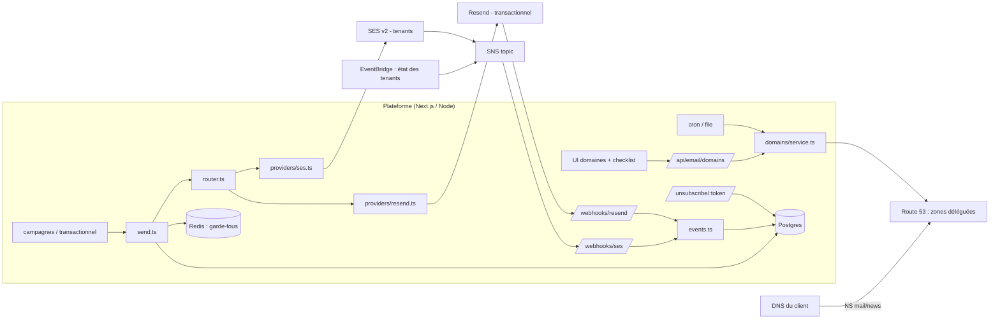

# Architecture de la brique email multi-tenant

Pourquoi la brique est construite ainsi. À lire avant d'adapter le gabarit ou de répondre à
« pourquoi pas tout sur Resend ? ».

## Sommaire
1. Vue d'ensemble
2. Répartition Resend / SES et raisons
3. Isolation entre clients
4. Cycle de vie d'un domaine client
5. Pipeline d'envoi
6. Événements et suppression
7. Quotas qui dimensionnent la plateforme
8. Coûts indicatifs

---

## 1. Vue d'ensemble



## 2. Répartition Resend / SES

| | Resend | Amazon SES v2 |
|---|---|---|
| Rôle par défaut | **transactionnel** (plateforme + clients) | **marketing** des clients |
| Isolation par client | aucune dans un même compte (« team ») | **SES Tenants** : réputation, pause et liste de suppression par client |
| Limite de débit | 10 req/s **partagées** par tout le compte | quota du compte, à répartir soi-même par tenant |
| Liste de suppression | partagée par toute la team | par tenant (`SuppressionScope: TENANT`) |
| Contacts / désinscriptions | partagés par toute la team | gérés par la plateforme |
| Risque | un client à > 4 % de bounces ou > 0,08 % de spam peut faire suspendre **tout** le compte | AWS met en pause **le tenant fautif** seulement |
| Domaines | 10 (Pro), 1 000 (Scale, +100 pour 20 $/mois) | 10 000 identités par région |
| DKIM | 1024 bits seulement | 2048 bits, rotation automatique |
| Données | stockées aux États-Unis quelle que soit la région d'envoi | dans la région choisie (UE possible) |
| Prix | 20–90 $/mois de base + 0,46–0,90 $/1 000 | 0,10 $/1 000 + tenants 0,005 $/tenant/mois + 0,005 $/1 000 |
| Atouts | DX, SDK, React Email, webhooks signés, mise en route en minutes | coût, isolation, contrôle, RGPD |

Conséquence : **Resend pour ce qui doit partir vite et peu** (codes, factures, invitations),
**SES pour ce qui part en volume et engage la réputation de chaque client**. Un même domaine
peut être vérifié chez les deux (DKIM et Return-Path distincts) pour basculer sans changer le From.

Alternative Resend « un compte par client » : chaque client crée son propre compte et autorise la
plateforme par **OAuth 2.1** (portées `emails:send`, `full_access`) — isolation totale, mais
facturation et onboarding côté client.

## 3. Isolation entre clients

| Niveau | Mécanisme |
|---|---|
| Domaine | `EmailDomain.name` unique sur la plateforme ; un tenant n'envoie que depuis ses domaines (`router.ts`) |
| Réputation SES | 1 tenant SES par client (`t-<tenantId>`), politique de réputation `standard` (pause sur constat grave) |
| Suppression | hard bounce → **global** (adresse invalide pour tous) ; plainte → **par tenant**, tous flux ; désinscription → par tenant, marketing seulement |
| Débit | garde-fous par destinataire (5/10 min, 20/24 h) + plafond de warm-up par domaine ; à compléter d'un plafond par tenant si le compte SES est partagé |
| Données | événements stockés par empreinte d'adresse (`sha256`), jetons de désinscription sans adresse |
| Clés | clés Resend restreintes à un domaine (`sending_access` + `domain_id`) si un client envoie depuis son code |

## 4. Cycle de vie d'un domaine client

```
création (région figée) → identités Resend/SES → zone Route 53 + records écrits
   → client pose les NS (ou copie les records) → délégation vérifiée → fournisseur vérifié
   → DMARC observé (avec rua) → auto-test webhooks (simulateurs) → one-click testé
   → Postmaster + Sender Hub confirmés → warm-up démarré → envoi marketing autorisé
   → fin du warm-up + rapports propres → DMARC quarantine → reject
```
Zone jamais déléguée après 7 jours : supprimée (évite qu'un tenant réserve le sous-domaine
d'une marque). Client qui part : **ne pas supprimer la zone** tant que ses NS pointent encore
vers nous (risque de reprise du sous-domaine) — la vider et le prévenir.

## 5. Pipeline d'envoi (`send.ts`)

1. route (domaine possédé, identité vérifiée, ordre de préférence par flux) ;
2. portes de mise en service (marketing : 6 conditions) — sauf simulateurs ;
3. suppression (globale + tenant) ;
4. garde-fous par destinataire ;
5. plafond de warm-up (marketing) ;
6. journal du message (clé d'idempotence unique) ;
7. en-têtes `List-Unsubscribe` + `List-Unsubscribe-Post` (marketing), tags `tenant`, `message`, `stream` ;
8. envoi, bascule vers l'autre fournisseur **seulement** sur échec d'identité.

## 6. Événements et suppression

- Resend : un seul endpoint, signature Svix, dédoublonnage sur `svix-id`, tenant lu dans
  `data.tags.tenant`. Nouveaux essais : 5 s, 5 min, 30 min, 2 h, 5 h, 10 h, 10 h.
- SES : configuration sets partagés → **SNS** → HTTPS ; signature SNS vérifiée, `TopicArn` contrôlé,
  dédoublonnage sur `MessageId`. Les changements d'état des tenants (EventBridge, `source: aws.ses`,
  « Sending Status Disabled/Enabled ») arrivent sur le même topic.
- Tout est idempotent et indépendant de l'ordre d'arrivée.

## 7. Quotas qui dimensionnent la plateforme

| Quota | Valeur | Effet sur la conception |
|---|---|---|
| SES configuration sets | 10 000 / région, non ajustable | partagés par flux, pas un par client |
| SES identités | 10 000 / région | au-delà : autre région ou autre compte |
| SES tenants | 10 000 par défaut (ajustable) | 1 par client |
| SES API de gestion | 1 requête/s | onboarding via file, cron séquentiel |
| SES en-têtes personnalisés | 15 / message | rester sobre |
| Route 53 zones | 500 / compte au départ (ajustable) | demander l'augmentation tôt |
| Route 53 jeu de serveurs réutilisable | 100 zones / jeu (ajustable), 100 jeux / compte | plusieurs jeux dans `ROUTE53_DELEGATION_SET_IDS` |
| Resend débit | 10 req/s par compte | file d'envoi, `emails.batch` (100) pour le transactionnel groupé |
| Resend endpoints webhook | 5 (Pro), 10 (Scale) | un seul endpoint, routage par tag |
| Cloudflare for SaaS | 100 hostnames inclus, puis 0,10 $ | domaines de tracking des clients |

## 8. Coûts indicatifs (octobre 2026, à revérifier)

| Poste | Hypothèse | Ordre de grandeur |
|---|---|---|
| SES envoi | 2 M emails/mois | 200 $ + tenants 10 $ + frais tenant 0,005 $/1 000 = 10 $ |
| Route 53 | 1 000 zones déléguées | 25 × 0,50 + 975 × 0,10 ≈ 110 $/mois + requêtes |
| Resend | 100 k transactionnels/mois, Scale (pour > 10 domaines) | 90 $/mois |
| Cloudflare for SaaS | 300 domaines de tracking | 20 $/mois |
